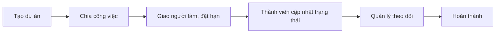

# Tổng quan nghiệp vụ — Quản lý Công việc

> Mô tả demo này cho ai, giải quyết vấn đề gì. Cập nhật khi phạm vi thay đổi.

---

## 1. Thông tin chung

| Mục | Nội dung |
| :--- | :--- |
| Tên demo | Quản lý Công việc |
| Mã dự án | `biz-quan-ly-cong-viec` |
| Ngành / loại khách hàng | Văn phòng, agency, đội dự án |
| Loại sản phẩm | Web quản lý |
| Ý tưởng gốc | 5.3 · Quản lý công việc / dự án (`ZDOCS/02-KE-HOACH/DANH-SACH-Y-TUONG.md`) |
| Người phụ trách | |
| Trạng thái | Có tài liệu nghiệp vụ (SRS, use case, kịch bản demo, kịch bản kiểm thử), chưa code |

## 2. Vấn đề của khách hàng

- Giao việc qua Zalo, tin nhắn bị trôi
- Không biết ai đang làm gì, việc nào trễ
- Báo cáo tiến độ dự án mất thời gian

## 3. Giải pháp demo thể hiện

- Dự án, thành viên
- Bảng Kanban kéo thả
- Công việc có người làm, hạn, mức ưu tiên, checklist, bình luận, đính kèm
- Xem dạng danh sách, lịch; nhắc việc sắp trễ
- Dashboard tiến độ, khối lượng việc theo người

## 4. Vai trò người dùng

| Vai trò | Mã | Dùng trên | Làm được gì |
| :--- | :--- | :--- | :--- |
| Quản trị viên | ADMIN | Desktop | Toàn quyền |
| Quản lý dự án | MANAGER | Desktop | Tạo dự án, giao việc, theo dõi |
| Thành viên | STAFF | Desktop, điện thoại | Việc của mình, cập nhật trạng thái |

## 5. Phân hệ và chức năng

| Area | Chức năng | Màn hình (route FE dự kiến) | Ưu tiên |
| :--- | :--- | :--- | :---: |
| `System` | Đăng nhập, tài khoản, vai trò, cài đặt | Có sẵn | — |
| `Work` | Dự án, thành viên | `/projects` | P1 |
| `Work` | Tổng quan dự án, thành viên dự án | `/projects/[id]` | P1 |
| `Work` | Bảng Kanban | `/projects/[id]/board` | P1 |
| `Work` | Dạng danh sách | `/projects/[id]/list` | P2 |
| `Work` | Công việc, checklist | `/tasks/[id]` | P1 |
| `Work` | Bình luận, đính kèm | `/tasks/[id]` | P2 |
| `Work` | Dạng lịch | `/projects/[id]/calendar` | P2 |
| `Work` | Nhắc việc trễ hạn | `/my-tasks` | P2 |
| `Work` | Dashboard tiến độ | `/dashboard` | P1 |

P1 = bắt buộc có để demo · P2 = nên có · P3 = làm thêm nếu còn thời gian.

## 6. Luồng nghiệp vụ chính

## 7. Phạm vi

**Có trong demo:**

- Dự án, Kanban, công việc, dashboard tiến độ

**Không làm (nói rõ với khách nếu được hỏi):**

- Chat thời gian thực
- Kết nối email, Slack
- Các kết nối bên ngoài khác chỉ giả lập

## 8. Dữ liệu mẫu cần chuẩn bị

| Dữ liệu | Số lượng | Ghi chú |
| :--- | :---: | :--- |
| Dự án | 5 |  |
| Thành viên | 15 |  |
| Công việc | 200 | Đủ trạng thái, có việc trễ hạn |
| Bình luận | 300 |  |
