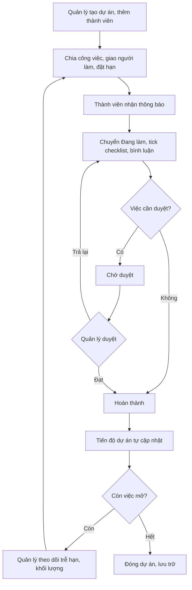
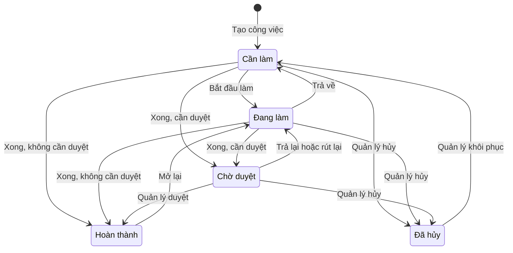
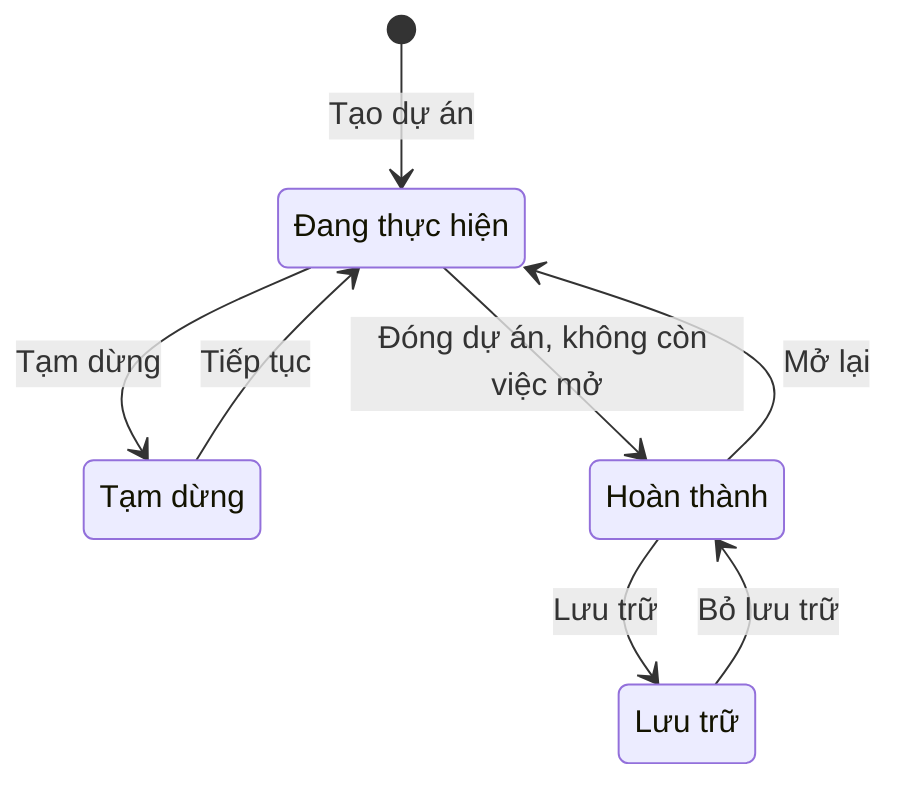

# Đặc tả yêu cầu phần mềm (SRS) — Quản lý Công việc

| Phiên bản | Ngày | Trạng thái |
| :--- | :--- | :--- |
| 1.0 | 12/10/2026 | Bản nháp để triển khai demo |

> Cách viết, quy ước mã, mức độ chi tiết: `ZDOCS/05-HUONG-DAN/HUONG-DAN-VIET-TAI-LIEU-NGHIEP-VU.md`.
> Phần nền (đăng nhập, tài khoản, vai trò, cài đặt, đặt lại dữ liệu demo): `ZDOCS/03-KIEN-TRUC/USE-CASE-NEN.md`, không viết lại ở đây.

---

## 1. Giới thiệu

### 1.1. Mục đích

Tài liệu mô tả đầy đủ yêu cầu của bản demo Quản lý Công việc: chức năng, quy tắc chuyển trạng thái, cách tính trễ hạn, tiến độ và khối lượng việc, dữ liệu, phân quyền theo thành viên dự án và danh sách màn hình. Dev dùng để code, tester dùng để viết và chạy test case, sales dùng để biết demo làm được gì.

### 1.2. Phạm vi

**Trong phạm vi:** dự án và thành viên, bảng Kanban, công việc có người làm, hạn, ưu tiên, ước lượng giờ, checklist, duyệt công việc, bình luận có nhắc tên, đính kèm tệp, dạng danh sách và lịch, việc của tôi, nhắc việc trong ứng dụng, tổng quan tiến độ và khối lượng việc. Thành viên chỉ thấy dự án mình tham gia.

**Ngoài phạm vi:** chat thời gian thực, cập nhật bảng tức thời giữa nhiều người (realtime), gửi nhắc qua email, Zalo, Slack, Teams (chỉ có thông báo trong ứng dụng), biểu đồ Gantt và việc phụ thuộc nhau, ghi giờ làm thực tế (timesheet), chi phí dự án, cổng xem tiến độ cho khách hàng bên ngoài.

### 1.3. Thuật ngữ

| Thuật ngữ | Giải thích |
| :--- | :--- |
| Dự án | Tập hợp công việc phục vụ một mục tiêu, có ngày bắt đầu, ngày kết thúc, thành viên, vd "Website bán hàng Nội thất Gỗ Việt" |
| Quản lý dự án | Người chịu trách nhiệm một dự án; tài khoản vai trò `MANAGER` |
| Thành viên | Người được thêm vào dự án; tài khoản vai trò `STAFF` chỉ thấy dự án mình là thành viên |
| Công việc | Một đầu việc cụ thể trong dự án, vd "Thiết kế banner trang chủ" |
| Người làm | Một người chịu trách nhiệm hoàn thành công việc; có thể để trống ("Chưa giao") |
| Người tạo | Người tạo công việc |
| Hạn | Ngày phải xong; tính đến hết 23:59 của ngày đó |
| Ước lượng | Số giờ dự kiến để làm xong công việc |
| Checklist | Danh sách bước nhỏ trong một công việc, mỗi bước đánh dấu xong riêng |
| Cần duyệt | Cờ trên công việc: làm xong phải được quản lý duyệt mới chuyển Hoàn thành |
| Việc mở | Công việc ở trạng thái Cần làm, Đang làm hoặc Chờ duyệt |
| Trễ hạn | Việc mở đã qua hạn |
| Tiến độ thực tế | Phần trăm việc đã hoàn thành của dự án |
| Tiến độ kế hoạch | Phần trăm thời gian của dự án đã trôi qua |
| Khối lượng tuần | Tổng giờ ước lượng của các việc mở một người đang làm, đến hạn trong 7 ngày tới hoặc đã trễ |
| Quá tải | Khối lượng tuần trên 40 giờ |
| Tỉ lệ đúng hạn | Phần trăm việc hoàn thành không muộn hơn hạn |
| Phạm vi dữ liệu | Giới hạn dự án người dùng nhìn thấy, theo `DataScope` của tài khoản |

### 1.4. Tài liệu liên quan

| Tài liệu | Nội dung |
| :--- | :--- |
| `01-TONG-QUAN-NGHIEP-VU.md` | Tổng quan nghiệp vụ |
| `03-USE-CASE.md` | Đặc tả use case |
| `05-KICH-BAN-KIEM-THU.md` | Test case nghiệm thu |
| `ZDOCS/03-KIEN-TRUC/USE-CASE-NEN.md` | Phần nền dùng chung |
| `ZDOCS/03-KIEN-TRUC/KIEN-TRUC-HE-THONG.md` §7.6 | Cơ chế `DataScope` |

---

## 2. Mô tả tổng quan

### 2.1. Bối cảnh sản phẩm

Văn phòng, agency, đội dự án 5–50 người, chạy song song nhiều dự án cho khách hàng và việc nội bộ. Quản lý dự án chia việc, giao người, đặt hạn, theo dõi tiến độ trên máy tính. Thành viên xem việc của mình, cập nhật trạng thái, tick checklist, trao đổi bằng bình luận ngay trên công việc, dùng cả máy tính và điện thoại. Hệ thống thay cho việc giao việc qua Zalo và báo cáo tiến độ bằng Excel.

Dữ liệu mẫu giả định một agency truyền thông số 15 người làm website, app, chiến dịch marketing và bộ nhận diện thương hiệu cho khách.

### 2.2. Tác nhân

| Mã vai trò | Tên | Thiết bị | Mục tiêu khi dùng hệ thống |
| :--- | :--- | :--- | :--- |
| `ADMIN` | Quản trị viên | Desktop | Cấu hình hệ thống, tài khoản, phân quyền |
| `MANAGER` | Quản lý dự án | Desktop | Tạo dự án, chia và giao việc, duyệt kết quả, phát hiện việc trễ, cân đối khối lượng giữa các thành viên |
| `STAFF` | Thành viên | Desktop, điện thoại | Biết hôm nay làm gì, cập nhật trạng thái nhanh, trao đổi trên đúng công việc, không trễ hạn |

Tài khoản demo:

| Tài khoản | Vai trò | Họ tên | Ghi chú |
| :--- | :--- | :--- | :--- |
| `admin` | `ADMIN` | Quản trị viên | |
| `quanly` | `MANAGER` | Lê Minh Quân | Quản lý dự án WEB, APP, HR |
| `nhanvien` | `STAFF` | Nguyễn Thu Hà | Thiết kế giao diện; thành viên dự án WEB, MKT, BRD; nút "Đăng nhập nhanh" vai trò Nhân viên |
| `nhanvien2` | `STAFF` | Phạm Đức Anh | Lập trình viên; thành viên dự án WEB, APP; dùng để demo phạm vi dữ liệu, đăng nhập bằng mật khẩu `DEMO_PASSWORD`, không có nút đăng nhập nhanh |

Dữ liệu mẫu có 15 người: 2 quản lý dự án (Lê Minh Quân, Hồ Thanh Tâm) và 13 thành viên, khớp `01-TONG-QUAN-NGHIEP-VU.md` §8.

### 2.3. Quy trình nghiệp vụ

### 2.4. Giả định và ràng buộc

- Một công ty, không chia phòng ban hay chi nhánh trong hệ thống.
- Phạm vi dữ liệu dùng cơ chế `DataScope` ở `KIEN-TRUC-HE-THONG.md` §7.6 nhưng không bật chi nhánh: chỉ dùng `All` và `Self`; với dự án này `Self` nghĩa là "dự án mình là thành viên".
- Mỗi công việc có tối đa một người làm. Không có việc con; bước nhỏ ghi bằng checklist.
- Trạng thái công việc cố định 4 cột Kanban (Cần làm, Đang làm, Chờ duyệt, Hoàn thành) và trạng thái Đã hủy; không tự thêm cột.
- Hạn là một ngày, không có giờ. Giờ hệ thống theo múi giờ Việt Nam (UTC+7). Mốc "7 ngày" tính theo ngày lịch, không trừ ngày nghỉ.
- Sức chứa mặc định 40 giờ mỗi người mỗi tuần, giống nhau cho mọi người.
- Thông báo chỉ trong ứng dụng (chuông). Bảng của người khác cập nhật khi tải lại trang hoặc sau lượt làm mới định kỳ, không realtime.

---

## 3. Yêu cầu chức năng

### 3.1. Tổng quan

| Mã | Yêu cầu | Ưu tiên | Vai trò | UC |
| :--- | :--- | :---: | :--- | :--- |
| FR-01 | Tổng quan của quản lý hiển thị 4 thẻ số: số dự án đang thực hiện, số việc mở, số việc trễ hạn, tỉ lệ đúng hạn 30 ngày | P1 | MANAGER | UC-11 |
| FR-02 | Tổng quan có bảng tiến độ các dự án đang thực hiện: tiến độ thực tế, tiến độ kế hoạch, tình trạng (Đúng tiến độ, Chậm tiến độ), số việc trễ, ngày kết thúc; bấm một dòng mở dự án | P1 | MANAGER | UC-11 |
| FR-03 | Tổng quan có biểu đồ khối lượng việc theo thành viên: số việc mở theo trạng thái, khối lượng tuần, nhãn "Quá tải" | P1 | MANAGER | UC-11 |
| FR-04 | Tổng quan của thành viên hiển thị số việc của tôi theo trạng thái, số việc trễ hạn, số việc đến hạn hôm nay, tiến độ các dự án mình tham gia | P1 | STAFF | UC-11 |
| FR-05 | Quản lý lọc Tổng quan theo một dự án | P2 | MANAGER | UC-11 |

### 3.2. Dự án và thành viên

| Mã | Yêu cầu | Ưu tiên | Vai trò | UC |
| :--- | :--- | :---: | :--- | :--- |
| FR-06 | Hệ thống cho phép quản lý tạo, sửa dự án: mã, tên, mô tả, khách hàng hoặc phòng ban, quản lý dự án, ngày bắt đầu, ngày kết thúc, màu | P1 | MANAGER | UC-01 |
| FR-07 | Danh sách dự án dạng thẻ hiển thị mã, tên, màu, tiến độ thực tế, tình trạng, số thành viên, số việc trễ, ngày kết thúc; lọc theo trạng thái, quản lý dự án; tìm theo tên, mã; mặc định ẩn dự án lưu trữ | P1 | MANAGER, STAFF | UC-01 |
| FR-08 | Trang tổng quan dự án hiển thị tiến độ thực tế và kế hoạch, số việc theo trạng thái, việc trễ hạn, thành viên kèm số việc mở, 20 hoạt động gần nhất | P1 | MANAGER, STAFF | UC-01 |
| FR-09 | Quản lý thêm, gỡ thành viên dự án; gỡ người còn việc mở thì phải giao lại các việc đó | P1 | MANAGER | UC-02 |
| FR-10 | Quản lý tạm dừng, tiếp tục, hoàn thành, mở lại, lưu trữ, bỏ lưu trữ dự án | P2 | MANAGER | UC-03 |

### 3.3. Công việc và checklist

| Mã | Yêu cầu | Ưu tiên | Vai trò | UC |
| :--- | :--- | :---: | :--- | :--- |
| FR-11 | Hệ thống cho phép tạo công việc gồm tiêu đề, mô tả (định dạng cơ bản: đậm, nghiêng, danh sách, liên kết), người làm, ngày bắt đầu, hạn, ưu tiên (Thấp, Trung bình, Cao, Khẩn cấp), ước lượng giờ, cờ Cần duyệt, checklist | P1 | MANAGER, STAFF | UC-04 |
| FR-12 | Người dùng thêm nhanh công việc ở đầu một cột Kanban chỉ bằng tiêu đề; các trường khác lấy mặc định | P1 | MANAGER, STAFF | UC-04 |
| FR-13 | Quản lý giao hoặc đổi người làm; người được giao và người bị chuyển việc nhận thông báo; ô chọn người làm hiển thị khối lượng tuần của từng người | P1 | MANAGER | UC-04 |
| FR-14 | Trang chi tiết công việc hiển thị thông tin, mô tả, checklist, bình luận, tệp đính kèm, lịch sử thay đổi; người có quyền sửa trực tiếp từng trường | P1 | MANAGER, STAFF | UC-06 |
| FR-15 | Người có quyền thêm, sửa, đánh dấu xong, kéo thả sắp xếp, xóa mục checklist; công việc hiển thị số mục xong trên tổng | P1 | MANAGER, STAFF | UC-06 |
| FR-16 | Quản lý hủy công việc kèm lý do và khôi phục công việc đã hủy | P2 | MANAGER | UC-06 |

### 3.4. Bảng Kanban

| Mã | Yêu cầu | Ưu tiên | Vai trò | UC |
| :--- | :--- | :---: | :--- | :--- |
| FR-17 | Bảng Kanban có 4 cột Cần làm, Đang làm, Chờ duyệt, Hoàn thành, đầu cột hiển thị số việc; thẻ hiển thị mã, tiêu đề, ảnh đại diện người làm, hạn, ưu tiên, checklist xong/tổng, số bình luận, số tệp | P1 | MANAGER, STAFF | UC-05 |
| FR-18 | Người dùng kéo thả thẻ để đổi trạng thái và thứ tự trong cột; hệ thống kiểm tra quyền và quy tắc chuyển trạng thái, sai thì trả thẻ về chỗ cũ kèm lý do | P1 | MANAGER, STAFF | UC-05 |
| FR-19 | Bảng lọc theo người làm, ưu tiên, hạn (Trễ hạn, Hôm nay, Tuần này, Không có hạn), từ khóa; nút "Việc của tôi" chỉ giữ thẻ mình làm | P1 | MANAGER, STAFF | UC-05 |
| FR-20 | Quản lý duyệt công việc Chờ duyệt sang Hoàn thành, hoặc trả lại Đang làm kèm lý do | P2 | MANAGER | UC-07 |
| FR-21 | Hệ thống gắn nhãn "Trễ {n} ngày" (đỏ), "Hôm nay", "Ngày mai" (cam) trên thẻ, dòng danh sách, lịch, việc của tôi | P1 | Hệ thống | UC-05, UC-10 |

### 3.5. Bình luận và đính kèm

| Mã | Yêu cầu | Ưu tiên | Vai trò | UC |
| :--- | :--- | :---: | :--- | :--- |
| FR-22 | Thành viên dự án bình luận trên công việc; gõ `@` để chọn thành viên dự án cần nhắc tên; người được nhắc nhận thông báo | P2 | MANAGER, STAFF | UC-08 |
| FR-23 | Tác giả sửa, xóa bình luận của mình trong 24 giờ; bình luận đã sửa hiển thị "(đã sửa)" | P2 | MANAGER, STAFF | UC-08 |
| FR-24 | Thành viên dự án đính kèm tệp vào công việc hoặc bình luận; xem trước ảnh và PDF, tải xuống; xóa tệp mình tải lên | P2 | MANAGER, STAFF | UC-08 |

### 3.6. Dạng danh sách và lịch

| Mã | Yêu cầu | Ưu tiên | Vai trò | UC |
| :--- | :--- | :---: | :--- | :--- |
| FR-25 | Dạng danh sách của dự án hiển thị bảng công việc, sắp xếp theo hạn, ưu tiên, người làm, trạng thái; nhóm theo trạng thái hoặc người làm; sửa nhanh trạng thái, hạn, người làm trên dòng theo quyền | P2 | MANAGER, STAFF | UC-09 |
| FR-26 | Dạng lịch tháng, tuần hiển thị công việc theo hạn (có ngày bắt đầu thì kéo dài từ ngày bắt đầu tới hạn), màu theo ưu tiên; kéo thả để đổi hạn theo quyền | P2 | MANAGER, STAFF | UC-09 |

### 3.7. Việc của tôi và nhắc việc

| Mã | Yêu cầu | Ưu tiên | Vai trò | UC |
| :--- | :--- | :---: | :--- | :--- |
| FR-27 | Trang Việc của tôi liệt kê việc mở mình làm trên mọi dự án tham gia, nhóm theo Trễ hạn, Hôm nay, 7 ngày tới, Sau này, Không có hạn; đổi trạng thái ngay trên dòng | P2 | MANAGER, STAFF | UC-10 |
| FR-28 | Hệ thống gửi thông báo trong ứng dụng lúc 08:00 hằng ngày: việc đến hạn ngày mai, việc đến hạn hôm nay, việc trễ hạn; báo quản lý dự án vào ngày trễ đầu tiên | P2 | Hệ thống | UC-10 |
| FR-29 | Chuông thông báo hiển thị số chưa đọc, danh sách thông báo mới nhất, đánh dấu đã đọc, bấm mở công việc; có thông báo khi được giao việc, được thêm vào dự án, được nhắc tên, việc mình làm có bình luận mới, việc gửi duyệt, được duyệt hoặc trả lại | P2 | MANAGER, STAFF | UC-10 |

### 3.8. Khác

| Mã | Yêu cầu | Ưu tiên | Vai trò | UC |
| :--- | :--- | :---: | :--- | :--- |
| FR-30 | Quản lý đặt công việc lặp lại hằng ngày, hằng tuần, hằng tháng; hoàn thành lần này thì hệ thống tự tạo lần sau | P3 | MANAGER | UC-12 |
| FR-31 | Quản lý xuất danh sách công việc đang lọc ra Excel | P3 | MANAGER | UC-13 |

---

## 4. Quy tắc nghiệp vụ

| Mã | Quy tắc | Áp dụng cho |
| :--- | :--- | :--- |
| BR-01 | Mã dự án 2–10 ký tự gồm chữ in hoa không dấu và số, bắt đầu bằng chữ, không trùng; không đổi được khi dự án đã có công việc. Tên dự án 3–100 ký tự. Ngày kết thúc không trước ngày bắt đầu | FR-06 |
| BR-02 | Mã công việc = mã dự án + `-` + số thứ tự trong dự án, bắt đầu từ 1, vd `WEB-15`; không dùng lại khi công việc bị xóa | FR-11, FR-12 |
| BR-03 | Tiêu đề công việc 3–200 ký tự. Người làm phải là thành viên dự án hoặc để trống. Hạn không trước ngày bắt đầu của công việc. Khi tạo hoặc đổi hạn, hạn mới không được trước hôm nay. Hạn sau ngày kết thúc dự án thì cảnh báo, vẫn lưu được. Ước lượng 0,5–200 giờ, bước 0,5, có thể để trống. Ưu tiên mặc định Trung bình | FR-11, FR-12, FR-13, FR-14, FR-26 |
| BR-04 | Quyền trên công việc: `MANAGER` làm mọi thao tác trên mọi dự án. `STAFF` chỉ thao tác trong dự án mình là thành viên: tạo công việc với người làm là chính mình; sửa, đổi trạng thái, sửa checklist của việc mình làm hoặc mình tạo; việc khác chỉ xem và bình luận. Chỉ `MANAGER` giao, đổi người làm, duyệt, hủy, khôi phục, xóa công việc | FR-11, FR-13, FR-14, FR-15, FR-16, FR-18, FR-25, FR-26 |
| BR-05 | Chuyển trạng thái: Cần làm ⇄ Đang làm. Việc không bật Cần duyệt: Cần làm hoặc Đang làm → Hoàn thành. Việc bật Cần duyệt: Cần làm hoặc Đang làm → Chờ duyệt; thành viên thả vào Hoàn thành thì hệ thống đưa vào Chờ duyệt và báo "Việc cần quản lý duyệt". Chờ duyệt → Hoàn thành khi quản lý duyệt (kéo thả hoặc bấm Duyệt); Chờ duyệt → Đang làm khi quản lý trả lại (lý do bắt buộc) hoặc người làm rút lại. Hoàn thành → Đang làm khi mở lại. Việc mở → Đã hủy chỉ do quản lý, lý do bắt buộc; Đã hủy → Cần làm khi quản lý khôi phục | FR-16, FR-18, FR-20 |
| BR-06 | Ngày hoàn thành ghi lúc công việc vào Hoàn thành; mở lại thì xóa ngày hoàn thành. Chuyển sang Hoàn thành khi checklist còn mục chưa xong thì hệ thống hỏi "Còn {x}/{y} mục chưa xong. Vẫn hoàn thành?"; người dùng xác nhận mới chuyển | FR-15, FR-18, FR-20 |
| BR-07 | Việc mở có hạn trước hôm nay thì gắn nhãn "Trễ {n} ngày", n = số ngày từ hạn tới hôm nay. Việc mở có hạn là hôm nay hoặc ngày mai thì gắn nhãn "Hôm nay" hoặc "Ngày mai". Việc Hoàn thành, Đã hủy không có nhãn | FR-17, FR-21, FR-27 |
| BR-08 | Tiến độ thực tế của dự án = số việc Hoàn thành ÷ (tổng số việc − số việc Đã hủy) × 100%, làm tròn xuống số nguyên. Dự án chưa có việc (hoặc mọi việc đã hủy) có tiến độ 0% | FR-02, FR-04, FR-07, FR-08 |
| BR-09 | Tiến độ kế hoạch = (hôm nay − ngày bắt đầu) ÷ (ngày kết thúc − ngày bắt đầu) × 100%, giới hạn 0–100%, làm tròn xuống số nguyên; ngày kết thúc trùng ngày bắt đầu thì kế hoạch là 100% từ ngày đó. Tình trạng "Chậm tiến độ" khi tiến độ thực tế nhỏ hơn tiến độ kế hoạch trừ 10 điểm phần trăm, hoặc đã qua ngày kết thúc mà thực tế chưa đạt 100%; còn lại là "Đúng tiến độ". Chỉ xét tình trạng cho dự án Đang thực hiện | FR-02, FR-07, FR-08 |
| BR-10 | Tỉ lệ đúng hạn = số việc hoàn thành trong kỳ có ngày hoàn thành không sau hạn ÷ số việc hoàn thành trong kỳ có hạn × 100%, làm tròn 1 chữ số thập phân; mẫu số bằng 0 thì hiển thị "—". Kỳ mặc định 30 ngày gần nhất | FR-01 |
| BR-11 | Khối lượng tuần của một người = tổng giờ ước lượng của các việc mở người đó làm, có hạn từ hôm nay tới hôm nay + 6 ngày hoặc đã trễ hạn. Việc không có ước lượng không cộng giờ nhưng vẫn đếm vào số việc. Khối lượng tuần trên 40 giờ thì gắn nhãn "Quá tải" màu đỏ | FR-03, FR-13 |
| BR-12 | Phạm vi dữ liệu: `STAFF` có `DataScope = Self`, chỉ thấy dự án mình là thành viên cùng toàn bộ công việc, bình luận, tệp của các dự án đó; Tổng quan, Việc của tôi, thông báo chỉ tính trong phạm vi này. `ADMIN`, `MANAGER` có `DataScope = All`. Lọc áp ở máy chủ. Mở URL dự án hoặc công việc ngoài phạm vi thì hiển thị "Không tìm thấy dự án hoặc bạn không phải thành viên". Bị gỡ khỏi dự án thì mất quyền xem từ lần tải kế tiếp | Mọi FR có dữ liệu |
| BR-13 | Quản lý dự án luôn là thành viên của dự án, không gỡ được. Gỡ thành viên còn việc mở thì phải chọn cho từng việc: giao cho thành viên khác hoặc để "Chưa giao". Việc đã Hoàn thành giữ tên người làm cũ. Một dự án tối đa 50 thành viên | FR-09 |
| BR-14 | Trạng thái dự án: Đang thực hiện ⇄ Tạm dừng; Đang thực hiện → Hoàn thành chỉ khi không còn việc mở; Hoàn thành → Đang thực hiện (mở lại); Hoàn thành ⇄ Lưu trữ. Dự án không ở Đang thực hiện thì chỉ xem: không tạo, sửa, kéo thả công việc, không bình luận, không gửi nhắc, không tính vào Tổng quan. Dự án Lưu trữ ẩn khỏi danh sách mặc định | FR-01, FR-02, FR-03, FR-10, FR-28 |
| BR-15 | Checklist tối đa 50 mục mỗi công việc, mỗi mục 1–200 ký tự | FR-15 |
| BR-16 | Bình luận 1–2.000 ký tự. `@` chỉ chọn được thành viên dự án. Tác giả sửa, xóa bình luận của mình trong 24 giờ kể từ lúc đăng; quản lý xóa được mọi bình luận. Bình luận bị xóa hiển thị "Bình luận đã bị xóa". Trả lại công việc (BR-05) tự thêm một bình luận chứa lý do | FR-22, FR-23 |
| BR-17 | Tệp đính kèm tối đa 10 MB mỗi tệp, 20 tệp mỗi công việc; định dạng jpg, png, gif, webp, pdf, doc, docx, xls, xlsx, ppt, pptx, zip. Người tải lên hoặc quản lý mới xóa được tệp. Chế độ `mock` chỉ lưu tên, kích thước và ảnh xem trước trên trình duyệt | FR-24 |
| BR-18 | Lúc 08:00 hằng ngày, hệ thống gửi cho người làm một thông báo cho mỗi việc mở đến hạn ngày mai, đến hạn hôm nay hoặc đang trễ hạn. Quản lý dự án nhận một thông báo cho mỗi việc vào ngày đầu tiên việc đó trễ hạn. Không gửi nhắc cho việc thuộc dự án không ở Đang thực hiện. Đặt lại dữ liệu demo tạo sẵn các thông báo của lượt 08:00 hôm nay; chế độ `mock` tính các thông báo này khi tải trang. Email, Zalo, Slack ngoài phạm vi demo | FR-28 |
| BR-19 | Thứ tự trong cột Kanban theo kéo thả của người dùng; việc mới nằm đầu cột. Dạng danh sách và Việc của tôi mặc định sắp theo hạn tăng dần, việc không có hạn ở cuối; cùng hạn thì theo ưu tiên Khẩn cấp, Cao, Trung bình, Thấp | FR-17, FR-25, FR-27 |
| BR-20 | Việc lặp lại chuyển Hoàn thành thì hệ thống tạo việc mới cùng tiêu đề, người làm, ước lượng, checklist (bỏ dấu xong), hạn cộng 1 ngày, 7 ngày hoặc 1 tháng theo kiểu lặp | FR-30 |
| BR-21 | Chỉ xóa được công việc ở Cần làm chưa có bình luận và tệp; việc khác chỉ hủy. Chỉ xóa được dự án chưa có công việc; dự án đã có việc thì lưu trữ | FR-06, FR-16 |

---

## 5. Yêu cầu dữ liệu

### 5.1. Thực thể

| Thực thể | Mô tả | Thuộc tính chính | Quan hệ |
| :--- | :--- | :--- | :--- |
| Dự án | Một dự án hoặc mảng việc | Mã, tên, mô tả, khách hàng hoặc phòng ban, ngày bắt đầu, ngày kết thúc, màu, trạng thái, số thứ tự công việc kế tiếp | Có một quản lý dự án; có nhiều thành viên, công việc |
| Thành viên dự án | Người tham gia dự án | Ngày tham gia | Nối một dự án với một người dùng |
| Công việc | Đầu việc trong dự án | Mã, tiêu đề, mô tả, trạng thái, thứ tự trong cột, ưu tiên, ngày bắt đầu, hạn, ước lượng giờ, cần duyệt, ngày hoàn thành, người duyệt, lý do hủy, kiểu lặp | Thuộc một dự án; có một người làm (có thể trống), một người tạo; có nhiều mục checklist, bình luận, tệp, lịch sử |
| Mục checklist | Bước nhỏ | Nội dung, đã xong, thứ tự, người đánh dấu, thời điểm | Thuộc một công việc |
| Bình luận | Trao đổi trên công việc | Nội dung, người nhắc tên, đã sửa, đã xóa, thời điểm | Thuộc một công việc; do một người viết; có nhiều tệp |
| Tệp đính kèm | Tệp tải lên | Tên tệp, loại, kích thước, đường dẫn lưu, thời điểm | Thuộc một công việc, có thể gắn với một bình luận; do một người tải lên |
| Lịch sử công việc | Một lần thay đổi | Trường thay đổi, giá trị cũ, giá trị mới, người thay đổi, thời điểm | Thuộc một công việc |
| Thông báo | Thông báo trong ứng dụng | Loại, nội dung, liên kết, đã đọc, thời điểm | Gửi cho một người dùng; có thể gắn một công việc hoặc dự án |

### 5.2. Vòng đời

**Công việc**

**Dự án**

"Trễ hạn", "Hôm nay", "Ngày mai", "Chậm tiến độ", "Quá tải" là nhãn tính theo ngày (BR-07, BR-09, BR-11), không phải trạng thái lưu.

### 5.3. Mã chứng từ

| Chứng từ | Định dạng | Ví dụ |
| :--- | :--- | :--- |
| Dự án | 2–10 ký tự chữ in hoa và số, bắt đầu bằng chữ, người dùng tự đặt | `WEB`, `MKT26` |
| Công việc | Mã dự án + `-` + số thứ tự trong dự án | `WEB-15`, `APP-108` |

---

## 6. Báo cáo

| Báo cáo | Chỉ số | Bộ lọc | Vai trò |
| :--- | :--- | :--- | :--- |
| Tổng quan quản lý | Số dự án đang thực hiện, việc mở, việc trễ hạn, tỉ lệ đúng hạn 30 ngày; bảng tiến độ dự án; khối lượng việc theo thành viên; 10 việc trễ lâu nhất | Dự án (P2) | MANAGER |
| Tổng quan thành viên | Việc của tôi theo trạng thái, việc trễ hạn, việc đến hạn hôm nay, tiến độ các dự án tham gia | — | STAFF |
| Tổng quan dự án | Tiến độ thực tế và kế hoạch, tình trạng, số việc theo trạng thái, việc trễ, số việc mở mỗi thành viên, hoạt động gần đây | — | MANAGER, STAFF (dự án tham gia) |

---

## 7. Phân quyền

> Quyền nền (`dashboard`, `users`, `roles`, `settings`, `audit-logs`) xem `USE-CASE-NEN.md` §7.

**Phạm vi dữ liệu** (BR-12)

| Vai trò | `DataScope` | Nhìn thấy |
| :--- | :--- | :--- |
| `ADMIN` | `All` | Toàn bộ |
| `MANAGER` | `All` | Mọi dự án, kể cả dự án mình không là thành viên |
| `STAFF` | `Self` | Dự án mình là thành viên và toàn bộ công việc trong đó |

**Ma trận quyền**

| Mã quyền | Mô tả | ADMIN | MANAGER | STAFF |
| :--- | :--- | :---: | :---: | :---: |
| `projects.view` | Xem dự án (theo phạm vi dữ liệu) | ✓ | ✓ | ✓ |
| `projects.create` / `update` | Tạo, sửa, đổi trạng thái dự án | ✓ | ✓ | |
| `projects.delete` | Xóa dự án chưa có công việc | ✓ | ✓ | |
| `project-members.update` | Thêm, gỡ thành viên dự án | ✓ | ✓ | |
| `tasks.view` | Xem công việc (theo phạm vi dữ liệu) | ✓ | ✓ | ✓ |
| `tasks.create` | Tạo công việc (STAFF: người làm là chính mình) | ✓ | ✓ | ✓ |
| `tasks.update` | Sửa, đổi trạng thái, sửa checklist (STAFF: việc mình làm hoặc mình tạo) | ✓ | ✓ | ✓ |
| `tasks.assign` | Giao, đổi người làm | ✓ | ✓ | |
| `tasks.approve` | Duyệt, trả lại việc Chờ duyệt | ✓ | ✓ | |
| `tasks.cancel` | Hủy, khôi phục công việc | ✓ | ✓ | |
| `tasks.delete` | Xóa công việc | ✓ | ✓ | |
| `tasks.export` | Xuất danh sách công việc ra Excel | ✓ | ✓ | |
| `task-comments.create` | Bình luận, sửa và xóa bình luận của mình trong 24 giờ | ✓ | ✓ | ✓ |
| `task-comments.delete` | Xóa bình luận của người khác | ✓ | ✓ | |
| `task-attachments.create` / `delete` | Tải lên tệp, xóa tệp mình tải lên | ✓ | ✓ | ✓ |
| `reports.view` | Xem Tổng quan toàn bộ dự án, khối lượng việc của mọi người | ✓ | ✓ | |

Thành viên vẫn xem Tổng quan của riêng mình bằng quyền nền `dashboard.view`.

---

## 8. Yêu cầu phi chức năng

> Yêu cầu chung (bảo mật JWT, phân quyền, tiếng Việt, chế độ dữ liệu mẫu) theo `ZDOCS/03-KIEN-TRUC/KIEN-TRUC-HE-THONG.md`. Ở đây chỉ ghi yêu cầu riêng của dự án.

| Mã | Yêu cầu |
| :--- | :--- |
| NFR-01 | Bảng Kanban mượt với 300 thẻ; kéo thả cập nhật giao diện ngay, dưới 100 ms, không chờ máy chủ; máy chủ từ chối (sai quyền, sai quy tắc) thì thẻ trả về chỗ cũ và hiện lý do |
| NFR-02 | Hai người cùng sửa một công việc: lần lưu sau chỉ ghi đè trường vừa sửa, không ghi đè trường khác. Bảng Kanban, Việc của tôi, chuông thông báo tự làm mới tối đa 30 giây một lần |
| NFR-03 | Việc của tôi, chi tiết công việc, bảng Kanban dùng được trên điện thoại rộng 375 px: Kanban cuộn ngang từng cột; đổi trạng thái bằng menu khi bấm giữ thẻ |
| NFR-04 | Phạm vi dữ liệu (BR-12) áp ở máy chủ cho mọi API, gồm cả tìm kiếm và tải tệp đính kèm |
| NFR-05 | Tổng quan tải dưới 2 giây với 10 dự án, 2.000 công việc |
| NFR-06 | Dữ liệu mẫu: 5 dự án (3 Đang thực hiện trong đó 1 chậm tiến độ, 1 Tạm dừng, 1 Hoàn thành), 15 người, 200 công việc đủ trạng thái, khoảng 10% việc mở trễ hạn, 300 bình luận; ngày tính tương đối so với hôm nay; có ít nhất 1 thành viên quá tải |

---

## 9. Danh sách màn hình

| Mã | Màn hình | Route | Vai trò | Thiết bị | UC |
| :--- | :--- | :--- | :--- | :--- | :--- |
| SCR-01 | Tổng quan | `/dashboard` | MANAGER, STAFF | Desktop, điện thoại | UC-11 |
| SCR-02 | Danh sách dự án | `/projects` | MANAGER, STAFF | Desktop, điện thoại | UC-01, UC-03 |
| SCR-03 | Hộp tạo, sửa dự án | `/projects` (hộp thoại) | MANAGER | Desktop | UC-01 |
| SCR-04 | Tổng quan dự án (tab Tổng quan, Thành viên) | `/projects/[id]` | MANAGER, STAFF | Desktop, điện thoại | UC-01, UC-02, UC-03 |
| SCR-05 | Bảng Kanban | `/projects/[id]/board` | MANAGER, STAFF | Desktop, điện thoại | UC-04, UC-05, UC-07 |
| SCR-06 | Hộp thêm công việc | `/projects/[id]/board` (hộp thoại) | MANAGER, STAFF | Desktop | UC-04 |
| SCR-07 | Chi tiết công việc (checklist, bình luận, tệp, lịch sử) | `/tasks/[id]` | MANAGER, STAFF | Desktop, điện thoại | UC-04, UC-06, UC-07, UC-08, UC-12 |
| SCR-08 | Dạng danh sách | `/projects/[id]/list` | MANAGER, STAFF | Desktop | UC-09, UC-13 |
| SCR-09 | Dạng lịch | `/projects/[id]/calendar` | MANAGER, STAFF | Desktop | UC-09 |
| SCR-10 | Việc của tôi | `/my-tasks` | MANAGER, STAFF | Desktop, điện thoại | UC-10 |
| SCR-11 | Chuông thông báo (trên header) | — | MANAGER, STAFF | Desktop, điện thoại | UC-02, UC-04, UC-07, UC-08, UC-10 |
