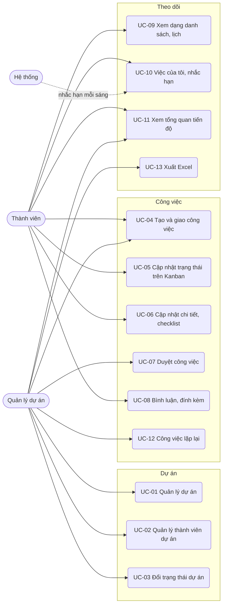

# Đặc tả use case — Quản lý Công việc

> Use case phần nền (UC-SYS-01 đến UC-SYS-10): `ZDOCS/03-KIEN-TRUC/USE-CASE-NEN.md`.
> Mã FR, BR, SCR tham chiếu `02-SRS.md`.

---

## 1. Tác nhân

| Tác nhân | Mã vai trò | Use case chính |
| :--- | :--- | :--- |
| Thành viên | `STAFF` | UC-04 (tạo việc cho mình), UC-05, UC-06, UC-08, UC-09, UC-10, UC-11 |
| Quản lý dự án | `MANAGER` | UC-01, UC-02, UC-03, UC-04, UC-05, UC-06, UC-07, UC-08, UC-09, UC-10, UC-11, UC-12, UC-13 |
| Hệ thống | — | UC-10 (gửi nhắc hạn lúc 08:00) |
| Quản trị viên | `ADMIN` | Toàn bộ, cộng phần nền |

---

## 2. Sơ đồ use case

Quản lý dự án làm được mọi việc của thành viên (UC-05, UC-06, UC-08, UC-09, UC-10) trên mọi dự án; sơ đồ không vẽ lại các đường này cho gọn.

---

## 3. Danh sách use case

| Mã | Tên | Tác nhân chính | Module | Ưu tiên | FR |
| :--- | :--- | :--- | :--- | :---: | :--- |
| UC-01 | Quản lý dự án | Quản lý dự án | Dự án | P1 | FR-06, FR-07, FR-08 |
| UC-02 | Quản lý thành viên dự án | Quản lý dự án | Dự án | P1 | FR-09 |
| UC-03 | Đổi trạng thái dự án | Quản lý dự án | Dự án | P2 | FR-10 |
| UC-04 | Tạo và giao công việc | Quản lý dự án | Công việc | P1 | FR-11, FR-12, FR-13 |
| UC-05 | Cập nhật trạng thái trên Kanban | Thành viên | Công việc | P1 | FR-17, FR-18, FR-19, FR-21 |
| UC-06 | Cập nhật chi tiết, checklist | Thành viên | Công việc | P1 | FR-14, FR-15, FR-16 |
| UC-07 | Duyệt công việc | Quản lý dự án | Công việc | P2 | FR-20 |
| UC-08 | Bình luận, đính kèm | Thành viên | Công việc | P2 | FR-22, FR-23, FR-24 |
| UC-09 | Xem dạng danh sách, lịch | Thành viên | Theo dõi | P2 | FR-25, FR-26 |
| UC-10 | Việc của tôi, nhắc hạn | Thành viên, Hệ thống | Theo dõi | P2 | FR-21, FR-27, FR-28, FR-29 |
| UC-11 | Xem tổng quan tiến độ | Quản lý dự án, Thành viên | Theo dõi | P1 | FR-01, FR-02, FR-03, FR-04, FR-05 |
| UC-12 | Công việc lặp lại | Quản lý dự án | Công việc | P3 | FR-30 |
| UC-13 | Xuất Excel | Quản lý dự án | Theo dõi | P3 | FR-31 |

---

## 4. Đặc tả chi tiết

### UC-01: Quản lý dự án

| Mục | Nội dung |
| :--- | :--- |
| Tác nhân chính | Quản lý dự án |
| Mô tả | Tạo, sửa dự án; xem danh sách và tổng quan dự án |
| Ưu tiên | P1 |
| Điều kiện kích hoạt | Ký hợp đồng với khách mới, bắt đầu một mảng việc nội bộ |
| Tiền điều kiện | Có quyền `projects.create` (tạo), `projects.view` (xem) |
| Hậu điều kiện | Dự án ở trạng thái Đang thực hiện, bảng Kanban trống, quản lý dự án là thành viên |
| Yêu cầu liên quan | FR-06, FR-07, FR-08, BR-01, BR-08, BR-09, BR-12, BR-21 |
| Màn hình | SCR-02, SCR-03, SCR-04 |

**Luồng chính**

1. Quản lý mở Dự án; hệ thống hiển thị thẻ các dự án trong phạm vi, mặc định ẩn dự án Lưu trữ, sắp theo ngày kết thúc gần nhất.
2. Quản lý bấm "Tạo dự án", nhập mã, tên, mô tả, khách hàng hoặc phòng ban, chọn quản lý dự án (mặc định là mình), ngày bắt đầu, ngày kết thúc, màu.
3. Bấm "Lưu"; hệ thống kiểm tra BR-01, tạo dự án trạng thái Đang thực hiện, thêm quản lý dự án vào danh sách thành viên.
4. Hệ thống mở trang tổng quan dự án ở tab Thành viên để thêm người (UC-02).

**Luồng thay thế**

- 1a. Tìm theo tên, mã; lọc theo trạng thái, quản lý dự án; bật "Hiện dự án lưu trữ".
- 1b. Xem tổng quan dự án: bấm một thẻ; trang hiển thị tiến độ thực tế và kế hoạch (BR-08, BR-09), tình trạng, số việc theo trạng thái, việc trễ hạn, thành viên kèm số việc mở, 20 hoạt động gần nhất; các tab chuyển sang Kanban, Danh sách, Lịch.
- 3a. Sửa dự án: mở dự án, bấm "Sửa", đổi thông tin, lưu; mã dự án chỉ sửa được khi chưa có công việc.

**Luồng ngoại lệ**

- E1. Mã dự án trùng hoặc sai định dạng: báo lỗi tại ô (BR-01).
- E2. Ngày kết thúc trước ngày bắt đầu: báo lỗi tại ô.
- E3. Thành viên mở Dự án: không có nút "Tạo dự án", chỉ thấy dự án mình tham gia (BR-12).
- E4. Xóa dự án đã có công việc: hệ thống từ chối, gợi ý lưu trữ (BR-21).

### UC-02: Quản lý thành viên dự án

| Mục | Nội dung |
| :--- | :--- |
| Tác nhân chính | Quản lý dự án |
| Mô tả | Thêm, gỡ người tham gia dự án, giao lại việc của người rời dự án |
| Ưu tiên | P1 |
| Điều kiện kích hoạt | Bắt đầu dự án, thay đổi nhân sự giữa chừng |
| Tiền điều kiện | Có quyền `project-members.update`; dự án Đang thực hiện |
| Hậu điều kiện | Người được thêm thấy dự án; người bị gỡ không còn thấy; việc mở của người bị gỡ đã có người nhận hoặc để "Chưa giao" |
| Yêu cầu liên quan | FR-09, BR-12, BR-13 |
| Màn hình | SCR-04, SCR-11 |

**Luồng chính**

1. Quản lý mở dự án, tab Thành viên; hệ thống liệt kê thành viên kèm chức danh, số việc mở, khối lượng tuần.
2. Bấm "Thêm thành viên", tìm theo tên hoặc email, chọn một hoặc nhiều người, bấm "Thêm".
3. Hệ thống thêm người vào dự án; mỗi người nhận thông báo "Bạn được thêm vào dự án {tên dự án}".
4. Để gỡ, quản lý bấm "Gỡ" ở một thành viên.
5. Người đó còn việc mở: hệ thống liệt kê các việc, mỗi việc có ô chọn người nhận thay (thành viên khác) hoặc "Chưa giao".
6. Quản lý bấm "Xác nhận"; hệ thống giao lại các việc, gỡ thành viên, ghi lịch sử từng việc, gửi thông báo cho người nhận.

**Luồng thay thế**

- 5a. Thành viên không còn việc mở: hệ thống chỉ hỏi xác nhận gỡ.

**Luồng ngoại lệ**

- E1. Gỡ quản lý dự án: nút "Gỡ" bị vô hiệu, chú thích "Đổi quản lý dự án trước" (BR-13).
- E2. Dự án đã có 50 thành viên: báo lỗi, không thêm (BR-13).
- E3. Tài khoản bị khóa không có trong danh sách chọn.
- E4. Thành viên mở tab Thành viên: chỉ xem, không có nút "Thêm", "Gỡ".

### UC-03: Đổi trạng thái dự án

| Mục | Nội dung |
| :--- | :--- |
| Tác nhân chính | Quản lý dự án |
| Mô tả | Tạm dừng, tiếp tục, đóng, mở lại, lưu trữ dự án |
| Ưu tiên | P2 |
| Yêu cầu liên quan | FR-10, BR-14 |
| Màn hình | SCR-02, SCR-04 |

**Luồng chính**

1. Quản lý mở tổng quan dự án, bấm menu "Trạng thái".
2. Chọn Tạm dừng, Tiếp tục, Hoàn thành, Mở lại, Lưu trữ hoặc Bỏ lưu trữ tùy trạng thái hiện tại (BR-14).
3. Chọn Hoàn thành khi còn việc mở: hệ thống báo số việc còn mở, liệt kê các việc và không đổi trạng thái.
4. Hợp lệ thì hệ thống đổi trạng thái; dự án không ở Đang thực hiện chuyển sang chỉ xem, không gửi nhắc, không tính vào Tổng quan.

### UC-04: Tạo và giao công việc

| Mục | Nội dung |
| :--- | :--- |
| Tác nhân chính | Quản lý dự án |
| Tác nhân phụ | Thành viên (tạo việc cho chính mình) |
| Mô tả | Chia dự án thành công việc, giao người làm, đặt hạn |
| Ưu tiên | P1 |
| Điều kiện kích hoạt | Lập kế hoạch đầu dự án, phát sinh việc mới, khách yêu cầu thêm |
| Tiền điều kiện | Dự án Đang thực hiện; có quyền `tasks.create` |
| Hậu điều kiện | Công việc có mã, nằm đầu cột tương ứng; người làm nhận thông báo |
| Yêu cầu liên quan | FR-11, FR-12, FR-13, BR-02, BR-03, BR-04, BR-11, BR-14 |
| Màn hình | SCR-05, SCR-06, SCR-07, SCR-11 |

**Luồng chính**

1. Quản lý mở bảng Kanban của dự án, bấm "Thêm công việc".
2. Nhập tiêu đề, mô tả; chọn người làm (mỗi người hiện khối lượng tuần, vd "Nguyễn Thu Hà — 36/40 giờ"), ngày bắt đầu, hạn, ưu tiên, ước lượng giờ; bật "Cần duyệt" nếu kết quả cần quản lý kiểm tra.
3. Thêm các mục checklist ngay trong hộp (không bắt buộc).
4. Bấm "Lưu"; hệ thống kiểm tra BR-03, cấp mã (BR-02), đặt thẻ vào đầu cột Cần làm.
5. Người làm nhận thông báo "Bạn được giao {mã} {tiêu đề}, hạn {dd/MM/yyyy}".

**Luồng thay thế**

- 1a. Thêm nhanh: gõ tiêu đề vào ô đầu một cột, nhấn Enter; việc tạo ở cột đó, ưu tiên Trung bình, không có hạn; quản lý tạo thì "Chưa giao", thành viên tạo thì người làm là chính mình.
- 2a. Thành viên tạo việc: ô người làm cố định là chính mình (BR-04).
- 2b. Người được chọn sẽ vượt 40 giờ sau khi thêm việc: ô người làm hiện cảnh báo vàng "Sẽ quá tải: {x} giờ trong 7 ngày", vẫn chọn được (BR-11).
- 5a. Đổi người làm: ở chi tiết công việc, quản lý chọn người khác; người mới nhận thông báo được giao, người cũ nhận thông báo "Việc {mã} đã chuyển cho {tên}".

**Luồng ngoại lệ**

- E1. Tiêu đề dưới 3 ký tự, hạn trước hôm nay, hoặc hạn trước ngày bắt đầu: báo lỗi tại ô, không lưu (BR-03).
- E2. Hạn sau ngày kết thúc dự án: cảnh báo vàng "Hạn sau ngày kết thúc dự án", vẫn lưu được.
- E3. Dự án Tạm dừng, Hoàn thành, Lưu trữ: không có nút "Thêm công việc" (BR-14).
- E4. Thành viên mở chi tiết việc mình tạo: không đổi được người làm.

### UC-05: Cập nhật trạng thái trên Kanban

| Mục | Nội dung |
| :--- | :--- |
| Tác nhân chính | Thành viên |
| Mô tả | Theo dõi việc trên bảng, lọc, kéo thả đổi trạng thái và thứ tự |
| Ưu tiên | P1 |
| Điều kiện kích hoạt | Bắt đầu làm, làm xong một việc, họp nhanh đầu ngày |
| Tiền điều kiện | Là thành viên dự án; có quyền `tasks.update` |
| Hậu điều kiện | Trạng thái, thứ tự lưu lại; lịch sử ghi nhận; tiến độ dự án tính lại |
| Yêu cầu liên quan | FR-17, FR-18, FR-19, FR-21, BR-04, BR-05, BR-06, BR-07, BR-08, BR-14, BR-19 |
| Màn hình | SCR-05 |

**Luồng chính**

1. Thành viên mở dự án, tab Kanban; hệ thống hiển thị 4 cột, đầu cột có số việc; thẻ có nhãn trễ hạn hoặc sắp đến hạn (BR-07).
2. Thành viên bấm "Việc của tôi"; bảng chỉ còn thẻ mình làm.
3. Kéo một thẻ từ Cần làm sang Đang làm; hệ thống lưu trạng thái, ghi lịch sử.
4. Làm xong, kéo thẻ (việc không cần duyệt, checklist đã xong hết) sang Hoàn thành; hệ thống ghi ngày hoàn thành, tiến độ dự án tính lại (BR-08), nhãn trễ hạn (nếu có) mất.

**Luồng thay thế**

- 2a. Lọc theo người làm, ưu tiên, hạn (Trễ hạn, Hôm nay, Tuần này, Không có hạn), từ khóa.
- 3a. Kéo trong cùng cột để đổi thứ tự (BR-19).
- 4a. Việc bật Cần duyệt: thả vào Hoàn thành thì hệ thống đưa thẻ vào Chờ duyệt, báo "Việc cần quản lý duyệt"; quản lý dự án nhận thông báo (UC-07).
- 4b. Checklist còn mục chưa xong: hệ thống hỏi "Còn {x}/{y} mục chưa xong. Vẫn hoàn thành?"; chọn "Hủy" thì thẻ về cột cũ (BR-06).
- 4c. Mở lại: kéo thẻ từ Hoàn thành về Đang làm; ngày hoàn thành bị xóa.
- 4d. Trên điện thoại: bấm giữ thẻ, chọn trạng thái mới trong menu (NFR-03).

**Luồng ngoại lệ**

- E1. Thành viên kéo thẻ của người khác: thẻ trả về chỗ cũ, báo "Bạn chỉ cập nhật được việc mình làm hoặc mình tạo" (BR-04).
- E2. Dự án không ở Đang thực hiện: bảng chỉ xem, không kéo được (BR-14).
- E3. Máy chủ báo lỗi khi lưu: thẻ trả về chỗ cũ, hiện thông báo (NFR-01).

### UC-06: Cập nhật chi tiết, checklist

| Mục | Nội dung |
| :--- | :--- |
| Tác nhân chính | Thành viên |
| Tác nhân phụ | Quản lý dự án (hủy, khôi phục) |
| Mô tả | Xem đầy đủ công việc, sửa thông tin, đánh dấu checklist, theo dõi lịch sử |
| Ưu tiên | P1 |
| Điều kiện kích hoạt | Cần đọc yêu cầu chi tiết, báo tiến độ từng bước, khách đổi hạn |
| Tiền điều kiện | Là thành viên dự án; sửa cần quyền theo BR-04 |
| Hậu điều kiện | Thông tin, checklist được lưu; lịch sử thay đổi được ghi |
| Yêu cầu liên quan | FR-14, FR-15, FR-16, BR-03, BR-04, BR-05, BR-06, BR-08, BR-12, BR-15, BR-21 |
| Màn hình | SCR-07 |

**Luồng chính**

1. Thành viên bấm vào thẻ; hệ thống mở trang chi tiết gồm mã, tiêu đề, trạng thái, người làm, người tạo, ngày bắt đầu, hạn, ưu tiên, ước lượng, cờ Cần duyệt, mô tả, checklist, bình luận, tệp, lịch sử.
2. Thành viên sửa trực tiếp trường cần đổi (vd ưu tiên, mô tả, hạn); hệ thống lưu khi rời ô và ghi lịch sử "{người} đổi {trường} từ {cũ} sang {mới}".
3. Ở checklist, thành viên thêm mục, tick mục đã xong, kéo thả sắp xếp; thanh checklist cập nhật, vd "2/4".

**Luồng thay thế**

- 2a. Đổi trạng thái bằng ô Trạng thái, áp cùng quy tắc như UC-05.
- 3a. Sửa nội dung hoặc xóa một mục checklist.
- 3b. Hủy công việc (quản lý): bấm "Hủy công việc", nhập lý do; việc chuyển Đã hủy, rời bảng Kanban, không tính vào tiến độ (BR-08). Khôi phục: ở tab Danh sách nhóm theo trạng thái, mở việc trong nhóm Đã hủy, bấm "Khôi phục"; việc về Cần làm.

**Luồng ngoại lệ**

- E1. Thành viên mở việc không phải mình làm hoặc mình tạo: mọi ô và checklist chỉ đọc; vẫn bình luận được (BR-04).
- E2. Hạn mới trước hôm nay hoặc trước ngày bắt đầu: báo lỗi, giữ giá trị cũ (BR-03).
- E3. Checklist đủ 50 mục: ô thêm mục bị vô hiệu (BR-15).
- E4. Mở URL công việc của dự án mình không tham gia: hiển thị "Không tìm thấy dự án hoặc bạn không phải thành viên" (BR-12).

### UC-07: Duyệt công việc

| Mục | Nội dung |
| :--- | :--- |
| Tác nhân chính | Quản lý dự án |
| Mô tả | Kiểm tra kết quả các việc cần duyệt, duyệt hoặc trả lại |
| Ưu tiên | P2 |
| Yêu cầu liên quan | FR-20, BR-05, BR-06, BR-16 |
| Màn hình | SCR-05, SCR-07, SCR-11 |

**Luồng chính**

1. Quản lý nhận thông báo "{tên} gửi duyệt {mã} {tiêu đề}", bấm để mở chi tiết công việc.
2. Quản lý xem mô tả, checklist, tệp đính kèm, bình luận.
3. Bấm "Duyệt" (hoặc kéo thẻ từ Chờ duyệt sang Hoàn thành trên Kanban); việc sang Hoàn thành, ghi ngày hoàn thành và người duyệt; người làm nhận thông báo.
4. Chưa đạt thì bấm "Trả lại", nhập lý do; việc về Đang làm, lý do thành một bình luận; người làm nhận thông báo.

### UC-08: Bình luận, đính kèm

| Mục | Nội dung |
| :--- | :--- |
| Tác nhân chính | Thành viên |
| Mô tả | Trao đổi ngay trên công việc, nhắc tên người liên quan, gửi tệp |
| Ưu tiên | P2 |
| Yêu cầu liên quan | FR-22, FR-23, FR-24, BR-14, BR-16, BR-17 |
| Màn hình | SCR-07, SCR-11 |

**Luồng chính**

1. Thành viên mở chi tiết công việc, gõ nội dung vào khung bình luận.
2. Gõ `@`; hệ thống gợi ý thành viên dự án; chọn người cần nhắc.
3. Kéo thả tệp vào khung bình luận hoặc bấm "Đính kèm" (BR-17).
4. Bấm "Gửi"; bình luận hiện ngay kèm tệp; người được nhắc, người làm và người tạo việc nhận thông báo, trừ chính người gửi.
5. Trong 24 giờ, tác giả bấm "Sửa" hoặc "Xóa" trên bình luận của mình (BR-16).

### UC-09: Xem dạng danh sách, lịch

| Mục | Nội dung |
| :--- | :--- |
| Tác nhân chính | Thành viên |
| Mô tả | Xem công việc của dự án dạng bảng và dạng lịch, sửa nhanh hạn và trạng thái |
| Ưu tiên | P2 |
| Yêu cầu liên quan | FR-25, FR-26, BR-03, BR-04, BR-07, BR-19 |
| Màn hình | SCR-08, SCR-09 |

**Luồng chính**

1. Thành viên mở dự án, tab Danh sách; hệ thống hiển thị bảng công việc có cột mã, tiêu đề, người làm, trạng thái, ưu tiên, hạn, checklist, sắp theo BR-19.
2. Bấm tiêu đề cột để sắp xếp lại; chọn "Nhóm theo" trạng thái hoặc người làm.
3. Sửa nhanh trạng thái, hạn ngay trên dòng; quản lý sửa được cả người làm (BR-04).
4. Chuyển sang tab Lịch, chọn tháng hoặc tuần; việc hiện theo hạn, có ngày bắt đầu thì kéo dài thành thanh, màu theo ưu tiên, việc trễ hạn viền đỏ.
5. Kéo một việc sang ngày khác để đổi hạn; hệ thống kiểm tra BR-03, BR-04 rồi lưu, sai thì trả về chỗ cũ.

### UC-10: Việc của tôi, nhắc hạn

| Mục | Nội dung |
| :--- | :--- |
| Tác nhân chính | Thành viên |
| Tác nhân phụ | Hệ thống (gửi nhắc lúc 08:00) |
| Mô tả | Xem mọi việc mình làm trên các dự án, nhận nhắc trước hạn và khi trễ |
| Ưu tiên | P2 |
| Yêu cầu liên quan | FR-21, FR-27, FR-28, FR-29, BR-07, BR-12, BR-14, BR-18, BR-19 |
| Màn hình | SCR-10, SCR-11 |

**Luồng chính**

1. Lúc 08:00, hệ thống gửi thông báo theo BR-18; thành viên mở ứng dụng thấy chuông có số chưa đọc.
2. Thành viên mở Việc của tôi; hệ thống hiển thị việc mở mình làm trên mọi dự án tham gia, nhóm Trễ hạn, Hôm nay, 7 ngày tới, Sau này, Không có hạn; mỗi dòng có chấm màu và mã dự án.
3. Thành viên đổi trạng thái ngay trên dòng hoặc bấm để mở chi tiết.
4. Thành viên bấm chuông, xem danh sách thông báo, bấm một thông báo để mở công việc, hoặc bấm "Đánh dấu tất cả đã đọc".

### UC-11: Xem tổng quan tiến độ

| Mục | Nội dung |
| :--- | :--- |
| Tác nhân chính | Quản lý dự án, Thành viên |
| Mô tả | Nắm tiến độ các dự án, việc trễ hạn, khối lượng việc từng người |
| Ưu tiên | P1 |
| Điều kiện kích hoạt | Đầu ngày, họp giao ban, khách hỏi tiến độ |
| Tiền điều kiện | Có quyền `dashboard.view`; phần toàn bộ dự án và khối lượng cần `reports.view` |
| Hậu điều kiện | Không thay đổi dữ liệu |
| Yêu cầu liên quan | FR-01, FR-02, FR-03, FR-04, FR-05, BR-07, BR-08, BR-09, BR-10, BR-11, BR-12, BR-14 |
| Màn hình | SCR-01 |

**Luồng chính (quản lý)**

1. Quản lý đăng nhập; hệ thống mở Tổng quan.
2. Hệ thống hiển thị 4 thẻ số theo FR-01, chỉ tính dự án Đang thực hiện (BR-14).
3. Hệ thống hiển thị bảng tiến độ dự án: thanh tiến độ thực tế, vạch tiến độ kế hoạch, tình trạng màu xanh "Đúng tiến độ" hoặc đỏ "Chậm tiến độ" (BR-09), số việc trễ, ngày kết thúc.
4. Hệ thống hiển thị biểu đồ cột chồng theo thành viên: số việc Cần làm, Đang làm, Chờ duyệt; nhãn khối lượng tuần; người trên 40 giờ có nhãn "Quá tải" (BR-11).
5. Hệ thống hiển thị 10 việc trễ hạn lâu nhất kèm người làm, dự án, số ngày trễ.

**Luồng thay thế**

- 1a. Thành viên đăng nhập: Tổng quan hiển thị số việc của tôi theo trạng thái, việc trễ hạn, việc đến hạn hôm nay, tiến độ các dự án Đang thực hiện mình tham gia (FR-04); không có biểu đồ khối lượng của người khác.
- 2a. Lọc theo một dự án (P2): mọi khối chỉ tính dự án đó.
- 3a. Bấm một dự án: mở tổng quan dự án.
- 4a. Bấm cột của một thành viên: hộp thoại liệt kê việc mở của người đó; quản lý mở từng việc để đổi người làm (UC-04, 5a).

**Luồng ngoại lệ**

- E1. Chưa có dự án Đang thực hiện: trạng thái trống kèm nút "Tạo dự án".
- E2. Không có việc hoàn thành có hạn trong 30 ngày: tỉ lệ đúng hạn hiển thị "—" (BR-10).
- E3. Thành viên không có `reports.view` gõ bộ lọc dự án mình không tham gia lên URL: hệ thống bỏ qua bộ lọc, chỉ hiện số liệu của mình (BR-12).
